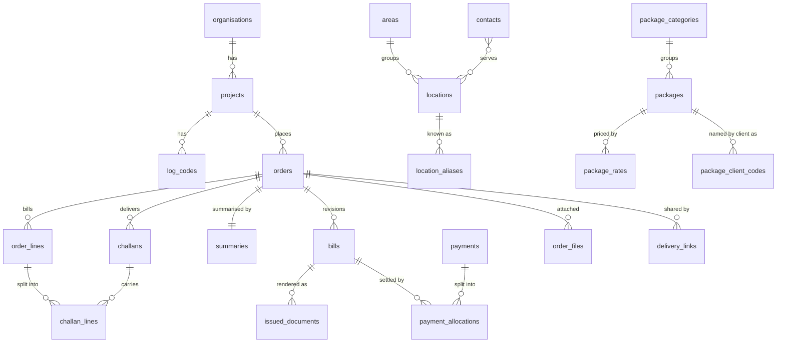

# Data model

**Status:** draft, started in Segment 0. Segment 2 turns it into migrations and updates this file to match what was built. BLUEPRINT §4 is the source; this document is the design.

## Conventions

- **Database:** Supabase Postgres 17. All business tables live in `public` with RLS on. Writes that touch money, numbering or locking go through Postgres functions, not ad-hoc table updates from the client.
- **Keys:** `id uuid primary key default gen_random_uuid()`. Human-facing numbers (order, bill, challan) are separate columns; ids are never shown.
- **Timestamps:** `created_at timestamptz not null default now()`, `updated_at` maintained by a trigger, `created_by uuid` → `auth.users`. Dates of delivery are `date`; times of day are `time`. The business runs on Asia/Dhaka time; date arithmetic that depends on "today" uses that zone explicitly.
- **Money:** `numeric(12,2)` for amounts, `numeric(10,2)` for rates, `numeric(5,4)` for the deduction rate (`0.1600` = 16%). Computed only in SQL. The client receives money as strings and only formats them.
- **Quantities:** `integer`, never negative. `10+2` is parsed to 12 at input; the raw text may be kept for display.
- **Bilingual text:** `*_en` is what clients write and what is printed; `*_bn` is for the UI and the Bangla datasheet. Package item text: English printed, Bangla UI-only.
- **Phones:** stored normalised as `01XXXXXXXXX` (11 digits, text).
- **Deletion:** business records are not hard-deleted once referenced by a document; directories use an `active` flag instead.

## Entity overview

## Tables

### Settings and people

| Table | Purpose and key columns |
|---|---|
| `business_settings` | Single row (`id boolean primary key default true check (id)`). Hotel name bn/en, proprietor bn/en, tagline, address, phones (`text[]`), storage paths of logo and header art, number prefix (`AMH`), fiscal year start month (7 = July). The document header reads this row; nothing is hard-coded. |
| `profiles` | One per admin, `id` = `auth.users.id`. Display name bn/en, phone, `language` (`bn`/`en`), `theme` (`system`/`light`/`dark`), `active`. The three admins have equal rights. |

### Clients

| Table | Purpose and key columns |
|---|---|
| `organisations` | e.g. World Vision Bangladesh. `name_en`, `name_bn`, notes. |
| `projects` | The billed client unit, e.g. Thakurgaon AP, REACTS-IN Project. `organisation_id`, `name_en`, `name_bn`, `billing_buyer_name`, `billing_address`, `deduction_rate numeric(5,4) default 0.16`, notes, `active`. |
| `log_codes` | Per project: `code` (`132.01.08`), `activity_en`, `activity_bn`. Unique `(project_id, code)`. |

### Places and people

| Table | Purpose and key columns |
|---|---|
| `areas` | Union / route used to split datasheets: `name_en`, `name_bn`. |
| `locations` | `name_en` (as clients write it), `name_bn` (datasheet), `area_id`, notes, `active`. |
| `location_aliases` | Spelling variants learned from imports (`Darapra` → `Darapara LR`). `alias_normalised` unique; `source` (`import`/`manual`). |
| `contacts` | Facilitators: `name_en`, `name_bn`, `phone` (normalised), notes, `active`. |
| `contact_locations` | Many-to-many contact ↔ location, optionally per project. |

### Packages

| Table | Purpose and key columns |
|---|---|
| `package_categories` | `name_en`, `name_bn`, `sort_order`. The new list has ten: Snacks, Lunch Basic, Lunch Standard, Lunch Premium, Hot Meal, Iftar, Drinks, Dessert, Disposable, Packing. |
| `packages` | `name` = the WV code (`Lunch Basic-07`), `category_id`, `rate numeric(10,2)` (current), `items jsonb` (ordered `[{ "en": "...", "bn": "..." }]`), notes, `active`. Shared prices are expected (৳20, 30, 35, 36, 60): price lookup returns a list, never one guess. |
| `package_rates` | Rate history: `package_id`, `rate`, `effective_from date`, `created_by`. Changing a rate adds a row; it only affects lines added afterwards. |
| `package_client_codes` | Other names a client uses for a package (`ADORSHA_HOTEL_PACKAGE_14_SNACKS_BASIC_3`), per organisation, for PO matching. |

### Orders and deliveries

| Table | Purpose and key columns |
|---|---|
| `orders` | `number` (`AMH/26-27/0047`), `fiscal_year` (`26-27`), `seq`, `project_id`, `title`, `po_number` (as written, `PBD-2794325`), `po_number_key` (normalised `PBD2794325`, matches bank SMS), `internal_ref`, `source` (`excel`/`pdf`/`photo`/`phone`/`manual`), `entry_mode` (`schedule`/`page_editor`), `status`, `date_from`, `date_to`, `next_challan_no`, notes. |
| `order_lines` | The **snapshot** of a package on this order: `package_id` (kept for reports only), `name`, `items jsonb`, `rate`, `position`, and `bill_qty integer null`. When `bill_qty` is null the bill quantity is the sum of the challan quantities; in page-editor mode it is typed. |
| `challans` | One delivery. `number` (stable per order, never renumbered), `delivery_date`, `delivery_time`, `location_id`, `log_code_id`, `contact_id`, printed `buyer_text` / `address_text` / `log_code_text` (editable, default from the structured fields), `position`, `delivered_at`, `delivered_via` (`ui`/`link`), `signed_returned`, `signed_photo_path`. |
| `challan_lines` | `challan_id`, `order_line_id`, `qty integer null` (null = not entered, flagged by the check panel; 0 = none). Unique `(challan_id, order_line_id)`. |
| `summaries` | One per order. Only the printed header fields are stored; the per-package quantities are derived from the challans. |
| `order_files` | Attachments: source file of the order, signed challan photos. `storage_path`, `filename`, `mime`, `size`, `sha256`, `kind`. |

### Bills and documents

| Table | Purpose and key columns |
|---|---|
| `bills` | `order_id`, `revision` (0 = original), `state` (`draft`/`issued`/`superseded`/`void`), `number` (null until issued), printed header fields (buyer, address, date, serial), and at issue the frozen `gross`, `deduction_rate`, `expected_net`, `amount_in_words`, `issued_at`, `issued_by`. `supersedes_bill_id` links a revision to the bill it replaces. |
| `issued_documents` | Every issued PDF: `bill_id`, `kind` (`bill`/`challans`/`summary`/`bundle`), `storage_path`, `sha256`, `page_count`, and `payload jsonb`, the exact data the PDF was rendered from. |

### Money in

| Table | Purpose and key columns |
|---|---|
| `payments` | `received_on`, `amount` (what reached the bank, net of deduction), `method` (`bank_eft`/`cash`/`other`), `bank_reference` (`PBD2778470`), `raw_sms`, notes. |
| `payment_allocations` | `payment_id`, `bill_id`, `received_amount`, `deduction_amount`. One payment can cover several bills. A bill is settled when Σ(received + deduction) equals its gross. |

### System

| Table | Purpose and key columns |
|---|---|
| `number_sequences` | `(scope, fiscal_year)` primary key, `last_value`. Allocated with a row lock inside the creating transaction, so numbers are atomic and never reused. |
| `audit_log` | `at`, `actor`, `channel` (`ui`/`ai`/`system`/`link`), `action`, `entity_type`, `entity_id`, `before jsonb`, `after jsonb`, `batch_id` (an AI action's changes share one id so they can be undone together). Written by triggers. |
| `import_profiles` | Per project and source kind: remembered column header → package mappings, so next month's file maps itself. |
| `delivery_links` | `token_hash` (the raw token is never stored), `order_id`, `delivery_date`, optional `area_id`, `expires_at`, `revoked_at`. |

## Invariants and where they are enforced

| Invariant | Enforcement |
|---|---|
| **Snapshot policy.** Package edits never change existing orders or documents. | `order_lines` copies name, items and rate when a line is added. Nothing renders from `packages` once a line exists. |
| **Issued means locked.** | Triggers reject changes to an order's lines, challans, challan lines, summary and bill header while its current bill is `issued`. Allowed after issue: delivery flags, signed-returned tracking and payments. **Revise** creates revision *n+1* as a draft and unlocks the order data for it; the issued revision stays as it was, and its PDFs and `payload` in `issued_documents` keep the original document. When the revision is issued, the previous one becomes `superseded`. |
| **One bill per order.** | Partial unique indexes: at most one `issued` and at most one `draft` bill per order. |
| **Numbering.** | Postgres functions allocate from `number_sequences` per fiscal year (July–June; `26-27` covers 2026-07-01 to 2027-06-30). Challan numbers come from `orders.next_challan_no`. |
| **Money in one place.** | Line amount, gross, deduction and expected net come from SQL functions or views. `expected_net = round(gross × (1 − deduction_rate), 2)`. Issue freezes them on the bill. |
| **Imports and AI only draft.** | Imports and AI produce draft orders; status moves out of `draft` only through an explicit confirm. |

## Derived values

- **Bill quantity of a line** = `coalesce(bill_qty, Σ challan_lines.qty)`. The difference between a typed bill quantity and the challan sum is shown, never hidden.
- **Line amount** = bill quantity × snapshot rate. **Gross** = Σ line amounts.
- **Summary** = per order line, Σ challan quantities.
- **Order status:** `draft` and `confirmed` are set by people; `delivering` when the first challan is delivered; `billed` on issue; `partially_paid` and `paid` from allocations; `cancelled` by people. Server functions validate every transition.
- **Receivable age** = days since issue of an unsettled bill; buckets 0–30, 31–60, 61–90, 90+.

## Security

- **RLS:** every table has RLS on. A `security definer` function `is_member()` checks that `auth.uid()` has an active profile; policies allow members to read and write, nobody else.
- **Delivery links:** the `anon` role gets no table access. A tokenised link calls two `security definer` functions, *view stops* and *mark delivered*, which check the token hash, expiry and scope (one order and date, optionally one area).
- **Storage buckets (all private):** `order-files`, `issued-documents`, `branding`, `backups`.
- **Secrets:** service-role/secret keys exist only in Edge Functions and the PDF service, never in the frontend bundle.

## Realtime

Published: `orders`, `challans` (delivery progress), `bills`, `payments`, `payment_allocations`, `audit_log` (activity feed). The client invalidates the matching queries on change and briefly highlights changed rows.

## Open questions for the owner

1. **Bill numbers.** The prototype reuses the order's digits (order `0047` → bill `B-0047`). Alternative: a separate gap-free bill sequence by issue date, which accountants usually expect. Also: which fiscal year applies when an order from June is billed in July?
2. **Revision numbers.** Keep the original number with a suffix (`AMH/26-27/B-0047-R1`) or allocate a new one?
3. **More than one challan for a place on one day.** The real Sep-26 schedule (`samples/wv-food-schedule-sep26-pfa6.pdf`) has Auliapur twice on 12/9 with the same log code (143.03.13) at 10:00 and at 3:00, and twice on 8/9 with different log codes. Proposal: a challan is one schedule row, unique on order × date × location × log code × time. Confirm in Segment 4.
4. **Packing lines** (Lunch Packing ৳30, Snacks Packing ৳2): separate bill lines, as the package list notes ask?
