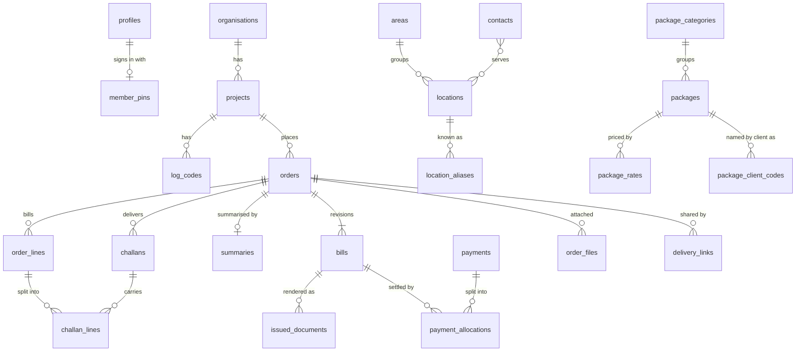

# Data model

**Status:** built in Segment 2 (`supabase/migrations/`, tested by `supabase/tests/`). BLUEPRINT §4 is the source; this document describes what the migrations create. Later segments add functions (issue, revise, record payment, delivery links) on top of these tables and must keep this file in step.

## Conventions

- **Database:** Supabase Postgres 17. Business tables live in `public`; internals (number sequences, PIN hashes, sign-in throttling) live in `private`, which the Data API never serves.
- **Default deny.** Migrations revoke Supabase's default grants: anon gets nothing anywhere, and members (`authenticated`) get only what each table grants, often column by column. Every table has RLS. `supabase/tests/database/00_security.test.sql` checks this for every table, view and function, including future ones.
- **Keys:** `id uuid primary key default gen_random_uuid()`. Human-facing numbers (order, bill, challan) are separate columns; ids are never shown.
- **Timestamps:** `created_at`, and `updated_at` kept by a trigger (`private.track_updates`). Main records also have `created_by` → `profiles`. Delivery dates are `date`, times `time`. "Today" is the date in Asia/Dhaka (`private.dhaka_today()`).
- **Money:** `numeric(12,2)` amounts, `numeric(10,2)` rates, `numeric(5,4)` deduction rates (`0.1600` = 16%). Computed only in SQL. The Data API returns `numeric` as JSON numbers; screens that show money select it cast to text (`gross::text`) so it stays exact, and only format it.
- **Quantities:** `integer`, never negative. What was typed (`10+2`) is kept beside the number.
- **Bilingual text:** `*_en` is what clients write and what is printed; `*_bn` is for the UI and the Bangla datasheet. Package items: English printed, Bangla UI-only.
- **Phones:** stored as `01XXXXXXXXX`. `private.normalise_phone` (and `apps/web/src/lib/phone.ts`) read Bangla digits, dashes, `+880`, and spreadsheet damage (`1638387433.0`).
- **Names and references** compare through keys: `private.name_key` ignores case, dots and spacing (unique indexes use it); `private.reference_key` drops punctuation so the PO `PBD-2794325` meets the bank SMS's `PBD2794325`.
- **Deletion:** directory rows are switched off with `active` once referenced; foreign keys from orders and documents are `restrict`.
- **Errors** that the app can explain use their own SQLSTATE codes: `AMH01` locked (`order_locked`, `bill_locked`, `issued_document_immutable`, `bill_not_issued`), `AMH02` immutable identity (`number_immutable`), `AMH03` status change not allowed, `AMH04` money totals (`payment_over_allocated`, `bill_over_settled`).
- **Triggers** are named `tNN_…` so they fire in a known order: `t05` bookkeeping, `t10` guards, `t20` preparation, `t50` deferred checks, `t90_audit`, `t95` follow-ups that should be logged after their cause.

## Entity overview

## Tables

### Settings and members

| Table | Purpose and key columns |
|---|---|
| `business_settings` | One row (`id boolean` = true). Hotel name, proprietor, tagline, address (bn/en), `phones text[]` (normalised), `logo_path`, `header_art_path` (branding bucket; null = built-in art), `number_prefix` (`AMH`), `fiscal_year_start_month` (7). Seeded by the first migration with the legacy header's text. Members read and edit it; nobody adds or removes rows. |
| `profiles` | One per member, `id` = `auth.users.id`. `phone` (unique; the sign-in name), `display_name_bn/en`, `language`, `theme`, `active`. Members see all profiles and edit only their own names and preferences; rows are created by member-auth only. |
| `private.member_pins` | `bcrypt(HMAC-SHA256(pepper, PIN))` per member. |
| `private.sign_in_throttle` | Mistakes per phone number (members or not): `failed_count`, `last_failed_at`, `locked_until`. |
| `private.sign_in_attempts` | Every PIN check: phone, member, purpose (`sign_in`/`verify`), outcome, client IP. |

### Clients, places, packages

| Table | Purpose and key columns |
|---|---|
| `organisations` | `name_en` (unique by name key), `name_bn`, notes, `active`. |
| `projects` | The billed unit. `organisation_id`, `name_en/bn` (unique per organisation), `billing_buyer_name`, `billing_address`, `deduction_rate` (default 0.1600, 0 ≤ rate < 1), notes, `active`. |
| `log_codes` | Per project: `code` (no spaces, unique per project), `activity_en/bn`, `active`. |
| `areas` | Union or route for splitting datasheets and delivery links. |
| `locations` | `name_en` (not unique: two unions can share a name), `name_bn`, `area_id`, notes, `active`. |
| `location_aliases` | Spellings seen in imports; the alias's name key is unique across all places. `source` `import`/`manual`. |
| `contacts` | Facilitators: names (at least one), `phone` (normalised). |
| `contact_locations` | Contact ↔ place, optionally per project; unique with nulls not distinct. |
| `package_categories` | `name_en/bn`, `sort_order`. |
| `packages` | `name` = the WV code (unique by name key), `category_id`, `rate` (current), `items jsonb` (`[{"en": …, "bn"?: …}]`, checked by `private.is_item_list`), notes, `active`. Shared prices are allowed and expected. |
| `package_rates` | Rate history, written by a trigger on every rate set; members read it only. |
| `package_client_codes` | A client's own name for a package (PO matching), unique per organisation. |

### Orders, deliveries, documents

| Table | Purpose and key columns |
|---|---|
| `orders` | `fiscal_year`, `seq`, `number` (assigned on insert, never changed), `project_id`, `title`, `po_number` + generated `po_number_key`, `internal_ref`, `source`, `entry_mode` (`schedule`/`page_editor`), `status`, `date_from/to`, notes. Creating an order creates its draft bill. |
| `order_lines` | The package snapshot: `package_id` (reports only), `name`, `items`, `rate`, `position`, `bill_qty` (null = sum of challans). An insert with only `package_id` copies the rest from the package; a line may carry an agreed rate instead. |
| `challans` | One delivery: `number` (stable per order, from `private.number_sequences`; deleted numbers are not reused), `delivery_date`, `delivery_time`, `location_id`, `log_code_id`, `contact_id`, printed `buyer_text`/`address_text`/`log_code_text` (filled from the project, place and log code when left empty), `position`, `delivered_at` + `delivered_via` (both or neither), `signed_returned`, `signed_photo_path`. |
| `challan_lines` | A quantity: `order_id` (filled from the challan), `challan_id`, `order_line_id`, `qty` (null = blank), `qty_input`. Composite keys keep the challan and the line in the same order; unique per challan and line (upserts welcome). |
| `summaries` | The optional summary page, one per order (`order_id` primary key); only its printed header. |
| `order_files` | Source files and signed-challan photos: `storage_path` (order-files bucket), filename, MIME type, size, SHA-256, optional `challan_id`. |
| `bills` | `revision` (0 = original), `state` (`draft`/`issued`/`superseded`/`void`), `supersedes_bill_id`, number fields (`fiscal_year`, `seq`, `number`; null until issued), printed header (`buyer_text`, `address_text`, `bill_date`, `serial_text`), frozen totals (`gross`, `deduction_rate`, `deduction`, `expected_net`, `amount_in_words`), `issued_at`, `issued_by`, `closed_at` (superseded or voided). Checks: drafts carry no issue data; issued bills carry all of it; `deduction = round(gross × rate, 2)` and `expected_net = gross − deduction`. Members may edit only the header, only while draft. |
| `issued_documents` | Every PDF made at issue: `bill_id` (must be issued), `kind`, `storage_path`, SHA-256, `page_count`, `byte_size`, `payload` (the exact render data). Never updated or deleted. |
| `import_profiles` | Per project and source: `header_map` (column header → package id). |
| `delivery_links` | `token_hash` (SHA-256; the token is never stored), `order_id`, `delivery_date`, optional `area_id`, `expires_at`, `revoked_at`. The token functions come in Segment 8. |

### Money in

| Table | Purpose and key columns |
|---|---|
| `payments` | `received_on`, `amount` (> 0; what reached the bank), `method`, `bank_reference` + generated `bank_reference_key`, `raw_sms`, notes. |
| `payment_allocations` | `payment_id`, `bill_id` (must be issued), `received_amount`, `deduction_amount`; unique per payment and bill. Deferred checks: a payment is not spread beyond its amount; an order is not settled beyond its issued gross (allocations on earlier revisions count). |

### System

| Table | Purpose and key columns |
|---|---|
| `private.number_sequences` | `(scope, key)` → `last_value`: `order`/`bill` by fiscal year, `challan` by order id. |
| `audit_log` | `at`, `actor`, `channel` (`ui`/`ai`/`system`/`link`), `action`, `entity_type`, `entity_id`, `order_id`, `before`, `after`, `batch_id`. Written by `t90_audit` triggers on every business table; append-only for everyone, the service role included. |

## Invariants and where they are enforced

| Invariant | Enforcement |
|---|---|
| **Snapshot policy.** | `t20_prepare_order_line` copies name, items and rate into the line; nothing renders from `packages` once a line exists. Tested: changing the package leaves the line as it was. |
| **Issued means locked.** | While an order has an issued bill and no draft revision (`private.order_is_locked`), `t10_guard_lock` triggers reject any change to its lines, challan quantities and summary, and any change to its challans except delivery and signed-copy columns; `t10_guard_order_update` rejects changing its client or entry mode. `t10_guard_bill` lets an issued bill change only to superseded or void, and never be deleted. `t10_guard_issued_document` makes issued documents write-once. A draft revision unlocks the order data; the issued revision keeps its frozen totals and its documents' payload. |
| **One bill per order.** | The bill row is created with the order; partial unique indexes allow one issued and one draft bill per order; `(order_id, revision)` is unique. Only server functions create bills (no insert grant). |
| **Numbering.** | `private.next_number` upserts the sequence row, which locks it until the transaction ends: numbers are handed out once, and a rolled-back transaction rolls the increment back, so committed numbers have no gaps. Orders get `AMH/26-27/0047` from the creation date's fiscal year. Bills get `AMH/27-28/B-0001` at issue (`private.bill_number_for`) from their own sequence by issue date; revision n keeps the original's number with `-Rn`. Numbers cannot be changed (`number_immutable`, and no column grants). |
| **Money in one place.** | The formulas live in `private.deduction_of` / `private.expected_net_of`, the views below, and the bills check constraint. |
| **Status changes.** | People may move an order between draft and confirmed, cancel it before it is billed, and reopen a cancelled one; anything else needs `amh.system_change` set by a server function. Payment allocations move a billed order to partially paid and paid and back (`t95_sync_payment_status`). |
| **Imports and AI only draft.** | New orders start as draft or confirmed only. |

## Figures (views; they run with the caller's rights, so RLS applies)

- `order_line_totals`: per line, `challan_qty` (sum of entered quantities), `bill_qty` (typed, else the challan sum), `bill_qty_typed`, `qty_differs` (typed and different: shown, never hidden), `amount` = bill quantity × rate.
- `order_totals`: per order, `gross`, the `deduction_rate` that applies (the issued bill's while locked, else the client's current rate), `deduction` = round(gross × rate, 2), `expected_net` = gross − deduction, `line_count`, `qty_differs_count`.
- `bill_balances`: per issued bill, `received`, `deducted` (over all revisions of the order), `outstanding` (gross terms), `expected_still` (net terms), `received_vs_expected`, `days_outstanding`, `age_bucket` (`0-30`, `31-60`, `61-90`, `90+`).

## Security

- **RLS:** every table; policies rest on `private.is_member()` (an active profile for `auth.uid()`). Inactive members and signed-in non-members see nothing, not even their own profile.
- **Sign-in:** phone number + 6-digit PIN through the `member-auth` Edge Function (see `supabase/functions/member-auth/handler.ts` and DECISIONS). Supabase Auth sign-ups are off; members are added by another member or by `npm run members` with the secret key.
- **Delivery links:** anon has no table or function access; Segment 8 adds two security-definer token functions as the only door.
- **Storage (private buckets):** `order-files` and `branding` (members read and write), `issued-documents` and `backups` (members read; only the service role writes).
- **Secrets:** the secret key and `AUTH_PIN_PEPPER` exist only in Edge Functions (and the PDF service later), never in the frontend bundle.

## Realtime

Only `audit_log` is published. Every business change writes one audit row naming its table, row and order, so a single subscription tells each open device what to refetch and what to highlight. Realtime applies RLS: only members receive changes.

## Decided questions (Segment 2)

1. **Bill numbers:** their own gap-free sequence by issue date, with the issue date's fiscal year (owner, 2026-10-20).
2. **Revision numbers:** the original number with `-R1`, `-R2` (owner).
3. **Packing lines:** ordinary packages added as bill lines (BLUEPRINT §2).

## Open questions

1. **More than one challan for a place on one day** (Segment 4). The Sep-26 schedule has Auliapur twice on 12/9 with the same log code at 10:00 and 3:00, and twice on 8/9 with different log codes. The schema allows it (no uniqueness on date × place); Segment 4 decides what the schedule grid treats as one challan.
